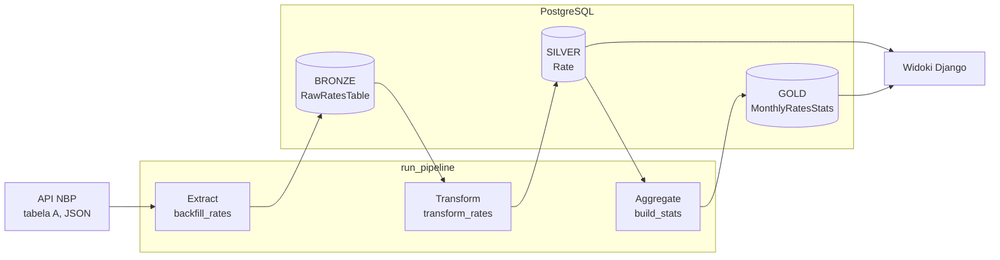

# NBP Data Pipeline

Pipeline ETL, który pobiera kursy walut z publicznego API Narodowego Banku Polskiego i przetwarza je w PostgreSQL zgodnie z **architekturą medalionu** (bronze → silver → gold).

Projekt skupia się na typowych problemach inżynierii danych: powtarzalnym przetwarzaniu, idempotentnym zapisie, ładowaniu danych historycznych, uzupełnianiu pominiętych dni oraz odtwarzaniu warstw bez ponownego odpytywania źródła. Django pełni tu rolę frameworka uruchomieniowego (ORM, migracje, komendy CLI) i cienkiej warstwy prezentacji.


## Najważniejsze cechy

- **Architektura medalionu** – surowy JSON, oczyszczone dane i agregaty są rozdzielone na osobne warstwy.
- **Idempotentność** – każdy krok można uruchomić wielokrotnie bez tworzenia duplikatów. Gwarantują to ograniczenia `UNIQUE` i operacje upsert.
- **Odtwarzalność** – warstwa bronze przechowuje pełną odpowiedź API, więc silver i gold można przebudować bez kontaktu ze źródłem.
- **Backfill** – zakres dat jest automatycznie dzielony na porcje mieszczące się w limicie API (93 dni na zapytanie).
- **Okno catch-up** – każde uruchomienie obejmuje ostatnie N dni, więc pominięte uruchomienie nadrabia się samo.
- **Fail-fast** – błąd w jednym kroku zatrzymuje pipeline, dzięki czemu kolejne warstwy nie budują się na niepełnych danych.
- **Testy** – 72 testy, a wszystkie komendy ETL i klient API mają 100% pokrycia.

## Architektura



## Warstwy danych

| Warstwa | Model | Ziarno (1 wiersz =) | Zawartość | Klucz unikalny |
| --- | --- | --- | --- | --- |
| **Bronze** | `RawRatesTable` | jedna tabela NBP z danego dnia | pełny JSON (`JSONField`), numer tabeli, czas pobrania | `effective_date` |
| **Silver** | `Rate` | jedna waluta w jednym dniu | kod i nazwa waluty, data, kurs `Decimal(12,6)` | `(currency_code, date)` |
| **Gold** | `MonthlyRatesStats` | jedna waluta w jednym miesiącu | średnia, minimum, maksimum, odchylenie standardowe | `(currency_code, month)` |

**Bronze** to wierna kopia źródła, zapisana bez żadnej interpretacji. Jeśli logika transformacji się zmieni albo pojawi się w niej błąd, dane można przeliczyć od nowa, bez ponownego pobierania historii.

**Silver** rozwija zagnieżdżony JSON do postaci relacyjnej: jedna tabela NBP daje około 30 wierszy, po jednym na walutę. Kursy są typu `Decimal`, a nie `float`, co eliminuje błędy zaokrągleń. Indeks na `date` przyspiesza zapytania po zakresie dat.

**Gold** zawiera dane gotowe do analizy. Agregacja działa po stronie bazy danych (`GROUP BY` przez `TruncMonth`, `Avg`, `Min`, `Max`, `StdDev`), więc wiersze dzienne nie są pobierane do Pythona.

## Przepływ ETL

Każdy etap to osobna komenda `manage.py`, którą można uruchomić samodzielnie. `run_pipeline` wykonuje je kolejno.

### Extract → Bronze

| Komenda | Zastosowanie |
| --- | --- |
| `fetch_rates --date RRRR-MM-DD` | pobranie tabeli z jednego dnia |
| `backfill_rates --start --end --sleep` | ładowanie zakresu dat, domyślnie ostatnich 365 dni |

Klient API (`apps/rates/nbp_client.py`) ma ustawione timeouty i rozróżnia dwie sytuacje:

- **404** – NBP nie publikuje tabel w weekendy i święta, więc to normalny brak danych, a nie błąd.
- **Inny status lub timeout** – awaria, która przerywa przetwarzanie.

`backfill_rates` dzieli zakres na porcje po maksymalnie 93 dni, robi pauzę między zapytaniami i zapisuje każdą tabelę przez `update_or_create`.

### Transform → Silver

`transform_rates` czyta JSON z warstwy bronze i wykonuje upsert po kluczu `(currency_code, date)`. Zakres można ograniczyć:

| Wywołanie | Przetwarzane dane |
| --- | --- |
| `transform_rates` | cała warstwa bronze (pełne przeliczenie) |
| `transform_rates --date 2026-10-09` | jeden dzień |
| `transform_rates --since 2026-10-01` | od wskazanej daty (tryb przyrostowy) |

### Aggregate → Gold

`build_stats` wylicza statystyki dla każdej pary waluta–miesiąc i zapisuje je jednym `bulk_create(update_conflicts=True)`, czyli `INSERT ... ON CONFLICT DO UPDATE` w PostgreSQL. Bieżący miesiąc jest aktualizowany przy każdym uruchomieniu.

### Orkiestracja

```bash
python manage.py run_pipeline             # okno catch-up: ostatnie 7 dni
python manage.py run_pipeline --days 30   # szersze okno, np. po dłuższej przerwie
```

Komenda wykonuje kroki `extract → transform → stats`, mierzy czas każdego z nich i kończy podsumowaniem: najnowsza tabela oraz liczba wierszy w każdej warstwie. Błąd w dowolnym kroku kończy się niezerowym kodem wyjścia, który może wykryć harmonogram.

NBP publikuje tabelę A około południa, więc przykładowy wpis crona na serwerze może wyglądać tak:

```cron
30 12 * * 1-5 cd /sciezka/do/repo && docker compose -f docker-compose.prod.yml exec -T web python manage.py run_pipeline
```

## Decyzje projektowe

| Decyzja | Uzasadnienie |
| --- | --- |
| Pełny JSON w bronze zamiast samych potrzebnych pól | Zmiana logiki nie wymaga ponownego pobierania danych, a historia źródła zostaje zachowana. |
| Upsert zamiast `INSERT` i ręcznego sprawdzania duplikatów | Ponowne uruchomienie jest bezpieczne, a NBP może skorygować dane, które wtedy zostaną nadpisane. |
| Ograniczenia `UNIQUE` w bazie | Spójność gwarantuje baza, a nie tylko kod aplikacji. |
| Okno catch-up zamiast pobierania tylko dzisiejszej daty | Awaria lub pominięte uruchomienie nie zostawia dziur w danych i nie wymaga ręcznej interwencji. |
| Transform ograniczony do okna, a agregacja po całej warstwie silver | Codzienny przebieg przetwarza tylko nowe dane, a przeliczenie gold jest tanie i zawsze spójne z silver. |
| Komendy CLI i cron zamiast Airflow czy Celery | Przy jednym źródle i jednym przebiegu dziennie orkiestrator byłby nadmiarowy. Komendy są niezależne, więc łatwo je później przenieść do zadań DAG-a. |

## Stack technologiczny

| Obszar | Technologie |
| --- | --- |
| Język i dane | Python 3.12, PostgreSQL 17, Django ORM, `requests` |
| Infrastruktura | Docker (multi-stage build, użytkownik non-root), Docker Compose, nginx, uWSGI |
| Jakość | pytest, pytest-django, pytest-mock, factory_boy, ruff, pre-commit, bandit, pip-audit |
| Obserwowalność | structlog (logi JSON), Sentry, Prometheus, Grafana, endpointy `/health/` |
| Zależności | `uv`, przypięte wersje w plikach `.lock` |

## Uruchomienie

Wymagania: Docker z Compose v2 oraz `make`.

```bash
git clone https://github.com/damiankrzystolik/data_pipeline.git
cd data_pipeline
cp .env.example .env        # uzupełnij SECRET_KEY, DB_NAME, DB_USER, DB_PASSWORD

make docker-build
make docker-up
make docker-migrate
```

Pierwsze załadowanie danych (rok historii):

```bash
alias dc="docker compose -f docker-compose.local.yml exec web python manage.py"

dc backfill_rates     # API NBP → bronze
dc transform_rates    # bronze → silver (pełne przeliczenie)
dc build_stats        # silver → gold
```

Późniejsze, regularne uruchomienia:

```bash
dc run_pipeline
```

Dane można przeglądać w panelu `/admin/` (konto tworzy `make docker-createsuperuser`), a kursy pod adresem `http://localhost/rates/`.

## Testy

```bash
make docker-test    # w kontenerze
make test           # lokalnie, z raportem pokrycia
```

Testy nie łączą się z API NBP, a odpowiedzi są mockowane. Działają na SQLite w pamięci, dzięki czemu cały zestaw wykonuje się w kilka sekund. Sprawdzają przede wszystkim właściwości pipeline'u:

- idempotentność każdego etapu: drugie uruchomienie niczego nie zmienia,
- podział zakresu dat na porcje po 93 dni,
- kolejność kroków i zatrzymanie pipeline'u po błędzie,
- nadrabianie pominiętych dni w oknie catch-up,
- dzień bez publikacji NBP nie jest traktowany jako błąd,
- poprawność agregatów i ograniczeń unikalności.

| Zakres | Pokrycie |
| --- | --- |
| Komendy ETL (`fetch`, `backfill`, `transform`, `build_stats`, `run_pipeline`) | 100% |
| Klient API NBP | 100% |
| Cały projekt | 83% (próg w konfiguracji: 70%) |

## Struktura projektu

```text
apps/
├── rates/                     # główna logika pipeline'u
│   ├── management/commands/   # etapy ETL jako komendy CLI
│   ├── models.py              # modele warstw bronze, silver i gold
│   ├── nbp_client.py          # klient API NBP
│   ├── selectors.py           # zapytania odczytowe
│   ├── views.py               # warstwa prezentacji
│   └── tests/
├── core/                      # healthchecki, middleware
└── users/                     # własny model użytkownika
config/                        # ustawienia, nginx, uWSGI, Prometheus, Grafana
requirements/                  # zależności dla środowisk i pliki .lock
docker-compose.*.yml           # środowiska local, test i prod
```

## Ograniczenia i dalszy rozwój

Obecne ograniczenia:

- Pipeline obsługuje **tabelę A** (kursy średnie). Tabela C ma inną strukturę (kupno/sprzedaż), a klucz bronze nie rozróżnia jeszcze typu tabeli.
- Harmonogram nie jest częścią repozytorium, a wpis crona trzeba dodać na serwerze.
- Testy działają na SQLite, a produkcja na PostgreSQL.
- Pliki statyczne widoków (`rates.css`, `rates.js`, Chart.js) nie są jeszcze dodane do repozytorium.

Planowane kroki:

- [ ] Testy jakości danych zapisywane w tabeli `DataQualityCheck`: brak wartości pustych, `mid > 0`, kompletność dni roboczych, wykrywanie skoków kursu powyżej 10%.
- [ ] Ponawianie zapytań z wykładniczym opóźnieniem.
- [ ] Wsadowy upsert w `transform_rates` zamiast zapisu wiersz po wierszu.
- [ ] Endpoint JSON `/api/rates/<kod>/?from=&to=`.
- [ ] Alerty o nieudanym przebiegu pipeline'u.
- [ ] Transformacje silver i gold jako modele dbt.
- [ ] Orkiestracja w Airflow lub Dagster.
- [ ] Eksport do Parquet i analiza w DuckDB.
- [ ] Drugie źródło danych łączone po dacie.

## Źródło danych

[API Narodowego Banku Polskiego](https://api.nbp.pl/): publiczne, bezpłatne, bez klucza API. Pojedyncze zapytanie obejmuje maksymalnie 93 dni.
